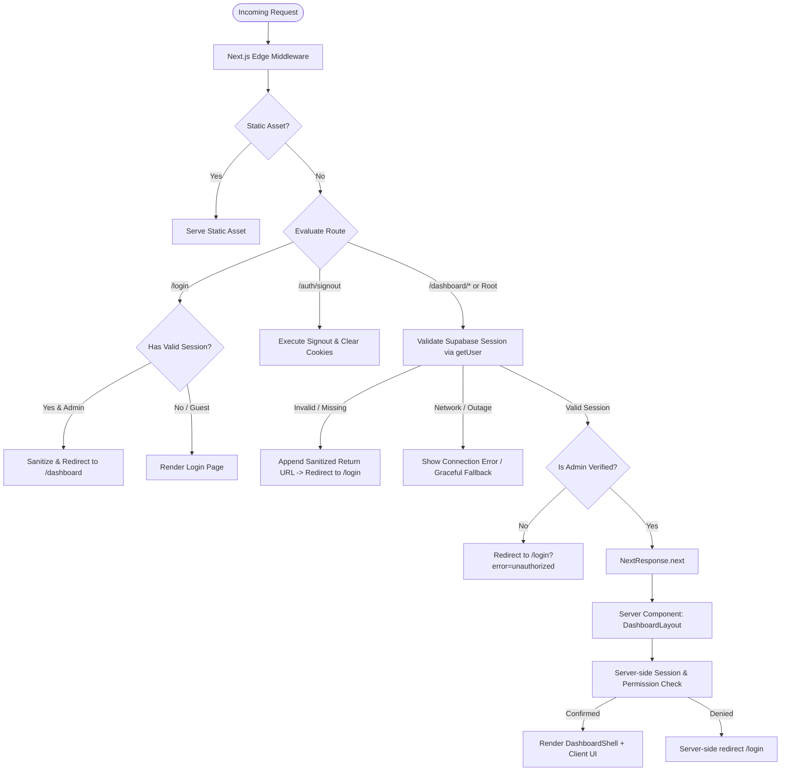

# CMS Authentication, Route Protection & Registration Flow Audit
## Phase 0 — Discovery & Security Audit Report (READ-ONLY)

**Report Date:** October 2026  
**Auditor:** Senior Next.js 14 & Supabase Security Architect  
**Target Repository:** `d:/Privatecompany/unlisted-cms`  
**Companion Portal:** `d:/Privatecompany/unlisted - portal`  
**Live Target Website:** [https://www.unlistedpond.com](https://www.unlistedpond.com)  
**Verification Baseline:** ✅ **TypeScript Compile Clean (`tsc --noEmit`), Production Build Green (`next build` 17/17 pages)**

---

## 1. Executive Summary

This Phase 0 Audit evaluates the authentication, authorization, route protection, and registration infrastructure of the **Unlisted CMS** (`unlisted-cms`), a standalone administrative Content Management System supporting the unlisted equity and DRHP IPO investment portal.

The application currently has a functioning login UI, Supabase session handling, and rudimentary route checks. However, our deep inspection has identified **7 critical architectural and security gaps**—including an **open redirect vulnerability**, **fail-open configuration bypasses**, **authorization logic desynchronization between edge middleware and server layouts**, and **unhandled exceptions during Supabase Auth server communication**.

**Strict Audit Constraint:** This phase is 100% read-only. No application source code has been altered and no dependencies have been installed.

---

## 2. Existing Architecture Summary

| Architectural Layer | Detected Technology & Configuration | Specific File Reference |
|---|---|---|
| **Framework & Router** | Next.js `14.2.18` (App Router) | [`package.json`](file:///d:/Privatecompany/unlisted-cms/package.json), [`next.config.mjs`](file:///d:/Privatecompany/unlisted-cms/next.config.mjs) |
| **Language & Typing** | TypeScript `5.x`, Strict Mode Enabled, Path alias `@/*` -> `./src/*` | [`tsconfig.json`](file:///d:/Privatecompany/unlisted-cms/tsconfig.json) |
| **Styling & UI Tokens** | Tailwind CSS `3.4.1`, CSS Variables in HSL, `tailwindcss-animate` | [`tailwind.config.ts`](file:///d:/Privatecompany/unlisted-cms/tailwind.config.ts), [`src/app/globals.css`](file:///d:/Privatecompany/unlisted-cms/src/app/globals.css) |
| **UI Primitives** | Radix UI primitives (`@radix-ui/react-dialog`, `tabs`, `select`, `label`, `slot`) | [`package.json`](file:///d:/Privatecompany/unlisted-cms/package.json) |
| **Icons Library** | `@hugeicons/react` & `@hugeicons/core-free-icons` (with `lucide-react` available) | [`src/components/layout/Sidebar.tsx`](file:///d:/Privatecompany/unlisted-cms/src/components/layout/Sidebar.tsx) |
| **Authentication Engine** | `@supabase/ssr` (`0.12.7`) & `@supabase/supabase-js` (`2.117.3`) | [`src/lib/supabase/client.ts`](file:///d:/Privatecompany/unlisted-cms/src/lib/supabase/client.ts), [`src/lib/supabase/server.ts`](file:///d:/Privatecompany/unlisted-cms/src/lib/supabase/server.ts) |
| **Auth Provider** | Supabase Auth (Email + Password only). No OAuth or passwordless magic links enabled. | [`src/app/login/page.tsx`](file:///d:/Privatecompany/unlisted-cms/src/app/login/page.tsx) |
| **Session & Token Storage** | HTTP cookies managed via `@supabase/ssr` (`getAll` / `setAll` cookie synchronization). | [`src/middleware.ts`](file:///d:/Privatecompany/unlisted-cms/src/middleware.ts), [`src/lib/supabase/server.ts`](file:///d:/Privatecompany/unlisted-cms/src/lib/supabase/server.ts) |
| **State Management** | React local state (`useState`, `useEffect`), Supabase `onAuthStateChange` listener, Server Components. | [`src/components/layout/Sidebar.tsx`](file:///d:/Privatecompany/unlisted-cms/src/components/layout/Sidebar.tsx) |
| **Edge Middleware** | `src/middleware.ts` matching all non-static paths, executing `supabase.auth.getUser()`. | [`src/middleware.ts`](file:///d:/Privatecompany/unlisted-cms/src/middleware.ts) |
| **Server-Side Guard** | `src/app/dashboard/layout.tsx` verifying session and admin role in Server Component. | [`src/app/dashboard/layout.tsx`](file:///d:/Privatecompany/unlisted-cms/src/app/dashboard/layout.tsx) |
| **Server Actions** | `verifyAdminSessionAction` for authoritative server-side privilege validation. | [`src/app/login/actions.ts`](file:///d:/Privatecompany/unlisted-cms/src/app/login/actions.ts) |
| **Data CRUD Layer** | Direct client-to-Supabase PostgREST queries in `src/lib/supabase/api.ts` (protected by PostgreSQL RLS). | [`src/lib/supabase/api.ts`](file:///d:/Privatecompany/unlisted-cms/src/lib/supabase/api.ts) |
| **Database Schema** | 8 PostgreSQL tables (`unlisted_shares`, `drhp_companies`, `blogs`, `videos`, `testimonials`, `homepage_content`, `admin_users`, `website_settings`, `lead_enquiries`, `partner_applications`). | [`supabase/migrations/`](file:///d:/Privatecompany/unlisted-cms/supabase/migrations) |

---

## 3. Discovered Route Classification Report

All routes in the Next.js App Router were discovered and verified against the compiled production build:

| # | Route | File Path | Current Access Behavior | Proposed Access Category | Auth Required | Access Rationale & Enforcement |
|---|---|---|---|---|:---:|---|
| 1 | `/` | [`src/app/page.tsx`](file:///d:/Privatecompany/unlisted-cms/src/app/page.tsx) | Server redirect to `/dashboard` | **Public Entry / Redirect** | **No** (Redirects) | Acts as root entrypoint. Redirects visitors to `/dashboard`, where middleware and layout guards intercept unauthenticated visitors and route them to `/login`. |
| 2 | `/login` | [`src/app/login/page.tsx`](file:///d:/Privatecompany/unlisted-cms/src/app/login/page.tsx) | Publicly accessible login form | **Guest-Only** | **No** | Designed strictly for unauthenticated users. Authenticated administrators must be redirected away from `/login` to `/dashboard` (unless viewing an explicit error state). |
| 3 | `/auth/signout` | [`src/app/auth/signout/route.ts`](file:///d:/Privatecompany/unlisted-cms/src/app/auth/signout/route.ts) | Route Handler (GET & POST) | **Protected / Session Op** | **Yes** (Valid Session) | Terminates active Supabase session, purges auth cookies, and issues HTTP 303 redirect to `/login`. |
| 4 | `/dashboard` | [`src/app/dashboard/page.tsx`](file:///d:/Privatecompany/unlisted-cms/src/app/dashboard/page.tsx) | Protected via Middleware + Layout | **Role-Protected (Admin)** | **Yes** | Executive dashboard displaying financial metrics, draft/published counts, and recent share records. |
| 5 | `/dashboard/leads` | [`src/app/dashboard/leads/page.tsx`](file:///d:/Privatecompany/unlisted-cms/src/app/dashboard/leads/page.tsx) | Protected via Middleware + Layout | **Role-Protected (Admin)** | **Yes** | Displays investor enquiries, PAN/Demat numbers, contact details, and institutional partner desk applications. Highly confidential PII. |
| 6 | `/dashboard/unlisted-shares` | [`src/app/dashboard/unlisted-shares/page.tsx`](file:///d:/Privatecompany/unlisted-cms/src/app/dashboard/unlisted-shares/page.tsx) | Protected via Middleware + Layout | **Role-Protected (Admin)** | **Yes** | Directory CRUD for pre-IPO stock valuations, prices, lot sizes, and publish states. |
| 7 | `/dashboard/drhp-companies` | [`src/app/dashboard/drhp-companies/page.tsx`](file:///d:/Privatecompany/unlisted-cms/src/app/dashboard/drhp-companies/page.tsx) | Protected via Middleware + Layout | **Role-Protected (Admin)** | **Yes** | SEBI DRHP filing tracker, IPO issue sizes, merchant bankers, and clearance status. |
| 8 | `/dashboard/research-reports` | [`src/app/dashboard/research-reports/page.tsx`](file:///d:/Privatecompany/unlisted-cms/src/app/dashboard/research-reports/page.tsx) | Protected via Middleware + Layout | **Role-Protected (Admin)** | **Yes** | Investment thesis notes, analyst credentials, key takeaways, and PDF downloads. |
| 9 | `/dashboard/blogs` | [`src/app/dashboard/blogs/page.tsx`](file:///d:/Privatecompany/unlisted-cms/src/app/dashboard/blogs/page.tsx) | Protected via Middleware + Layout | **Role-Protected (Admin)** | **Yes** | Editorial articles, market guides, author assignments, and draft states. |
| 10 | `/dashboard/videos` | [`src/app/dashboard/videos/page.tsx`](file:///d:/Privatecompany/unlisted-cms/src/app/dashboard/videos/page.tsx) | Protected via Middleware + Layout | **Role-Protected (Admin)** | **Yes** | YouTube video embeds, educational masterclasses, and publication status. |
| 11 | `/dashboard/testimonials` | [`src/app/dashboard/testimonials/page.tsx`](file:///d:/Privatecompany/unlisted-cms/src/app/dashboard/testimonials/page.tsx) | Protected via Middleware + Layout | **Role-Protected (Admin)** | **Yes** | Client testimonials, ratings, and customer reviews. |
| 12 | `/dashboard/homepage` | [`src/app/dashboard/homepage/page.tsx`](file:///d:/Privatecompany/unlisted-cms/src/app/dashboard/homepage/page.tsx) | Protected via Middleware + Layout | **Role-Protected (Admin)** | **Yes** | Live portal homepage hero headlines, announcement bar, and CTA button destinations. |
| 13 | `/dashboard/settings` | [`src/app/dashboard/settings/page.tsx`](file:///d:/Privatecompany/unlisted-cms/src/app/dashboard/settings/page.tsx) | Protected via Middleware + Layout | **Role-Protected (Admin)** | **Yes** | Global platform parameters, support contacts, registered address, and API endpoints. |
| 14 | `/_not-found` | Built-in Next.js 404 handler | Static 404 page | **Public** | **No** | Standard missing resource handler. |

---

## 4. Audit of Existing Authentication & Session Flow

### A. Login Submission Flow
1. User enters Email and Password in [`src/app/login/page.tsx`](file:///d:/Privatecompany/unlisted-cms/src/app/login/page.tsx).
2. Client invokes `supabase.auth.signInWithPassword({ email, password })`.
3. If credentials match, Supabase Auth issues JWT access & refresh tokens in HTTP cookies.
4. Client then calls the Server Action `verifyAdminSessionAction(access_token)` to verify administrator claims.
5. If verified, user is redirected to `searchParams.get('redirect') || '/dashboard'`.
6. If unverified (authenticated user lacks admin role), client calls `supabase.auth.signOut()` and displays an explicit access denied notice.

### B. Session Validation Mechanism
- The authoritative session check is performed using `supabase.auth.getUser()`.
- Unlike `supabase.auth.getSession()` (which merely inspects the client-side JWT without contacting the auth server), `getUser()` sends an authenticated request to the Supabase Auth server, securely verifying that the JWT has not been revoked or tampered with.

### C. Admin Role Authorization Structure
The project uses a three-tier authorization model:
1. **Tier 1 (Tamper-proof App Metadata):** `user.app_metadata.role === 'admin' | 'superadmin'` or `user.app_metadata.is_admin === true`.
2. **Tier 2 (Environment Allowlist):** `ADMIN_EMAILS` environment variable containing normalized, comma-separated email addresses.
3. **Tier 3 (Database Table Allowlist):** Querying `public.admin_users` table in Supabase PostgreSQL by `user_id` or `email`.
- **Untrusted Metadata:** `user.user_metadata` is explicitly ignored for authorization because users could modify client-side metadata via the public SDK.

### D. Logout & Session Termination
- Initiated in [`src/components/layout/Sidebar.tsx`](file:///d:/Privatecompany/unlisted-cms/src/components/layout/Sidebar.tsx).
- Executes `supabase.auth.signOut()` on client, then fires `fetch('/auth/signout', { method: 'POST' })` to invalidate server cookies, and finally triggers `router.push('/login')` and `router.refresh()`.

### E. Registration Flow
- **Audit Finding:** **Public self-registration is strictly disabled.**
- There is no registration route, no signup form, and no self-service account creation mechanism.
- [`src/app/login/page.tsx`](file:///d:/Privatecompany/unlisted-cms/src/app/login/page.tsx) and [`README.md`](file:///d:/Privatecompany/unlisted-cms/README.md) explicitly state:
  > *"Invite-Only Administrator Access: Public signups are strictly disabled. Only administrators created in Supabase Auth with verified admin privileges can access this panel."*
- All accounts must be pre-provisioned in Supabase Auth (Dashboard -> Authentication -> Users).

---

## 5. Security Gaps & Vulnerabilities Discovered

### 🚨 Gap 1: Open Redirect Vulnerability in Login & Middleware
- **Location:** [`src/middleware.ts:73`](file:///d:/Privatecompany/unlisted-cms/src/middleware.ts#L73) and [`src/app/login/page.tsx:29`](file:///d:/Privatecompany/unlisted-cms/src/app/login/page.tsx#L29)
- **Vulnerability:** The redirect parameter is consumed directly from query parameters without validation:
  ```ts
  const target = request.nextUrl.searchParams.get('redirect') || '/dashboard';
  return NextResponse.redirect(new URL(target, request.url));
  ```
  In Next.js / Node.js, `new URL('https://evil.com', request.url)` returns `https://evil.com/`. An attacker crafting a link like `/login?redirect=https://evil.com` or `/login?redirect=//evil.com` can redirect an administrator to an external credential-harvesting phishing site immediately after successful login!
- **Required Fix:** Strict return URL validation requiring relative paths starting with a single `/` and rejecting `//`, absolute URLs, and pseudo-protocols (`javascript:`, `data:`).

### 🚨 Gap 2: Fail-Open Configuration Bypass
- **Location:** [`src/middleware.ts:16-18`](file:///d:/Privatecompany/unlisted-cms/src/middleware.ts#L16-L18) and [`src/app/dashboard/layout.tsx:20`](file:///d:/Privatecompany/unlisted-cms/src/app/dashboard/layout.tsx#L20)
- **Vulnerability:**
  ```ts
  // In middleware.ts
  if (!isValid || !url || !key) {
    return response; // FAILS OPEN!
  }
  // In dashboard/layout.tsx
  if (supabase) {
    ...
  }
  return <DashboardShell>{children}</DashboardShell>; // FAILS OPEN!
  ```
  If environment variables are missing, misconfigured, or temporarily unreadable in production, the application completely skips authentication checks, rendering the entire dashboard layout and exposing mock data structures.
- **Required Fix:** Fail closed in production. If auth cannot be established or credentials are invalid, redirect or render an explicit configuration/error state rather than passing unauthenticated users through to private screens.

### 🚨 Gap 3: Incomplete Route Matching in Edge Middleware
- **Location:** [`src/middleware.ts:47-49`](file:///d:/Privatecompany/unlisted-cms/src/middleware.ts#L47-L49)
- **Vulnerability:** Middleware only inspects `pathname.startsWith('/dashboard')`.
  If a developer introduces a new top-level administrative route (e.g., `/settings`, `/admin`, `/reports`, or internal `/api/` route handlers), middleware will not intercept it by default.
- **Required Fix:** Structure middleware route matching to protect all routes by default, explicitly whitelisting only public resources (`/login`, `/_not-found`, static assets).

### 🚨 Gap 4: Authorization Logic Desynchronization
- **Location:** [`src/middleware.ts:59`](file:///d:/Privatecompany/unlisted-cms/src/middleware.ts#L59) vs [`src/app/dashboard/layout.tsx:36-45`](file:///d:/Privatecompany/unlisted-cms/src/app/dashboard/layout.tsx#L36-L45)
- **Vulnerability:**
  - `middleware.ts` evaluates `isUserAdmin(user)` which only checks `app_metadata` and `process.env.ADMIN_EMAILS`.
  - `DashboardLayout` and `verifyAdminSessionAction` check `app_metadata`, `ADMIN_EMAILS`, **and** query the PostgreSQL `admin_users` table.
  - If a user is authorized solely via the `admin_users` table, `middleware.ts` mistakenly rejects them with `?error=unauthorized`, causing an authorization mismatch and redirect ping-pong.
- **Required Fix:** Centralize the authorization evaluation into a single authoritative source of truth. Ensure middleware either has cached/tamper-proof claims in `app_metadata` or passes verification downstream to the layout where database lookups succeed.

### 🚨 Gap 5: Unhandled Exceptions on Supabase Auth Outages
- **Location:** [`src/middleware.ts:44`](file:///d:/Privatecompany/unlisted-cms/src/middleware.ts#L44)
- **Vulnerability:** `await supabase.auth.getUser()` in middleware is not wrapped in a `try/catch` block. If Supabase Auth encounters a network glitch, DNS timeout, or rate-limiting error, middleware throws an unhandled exception resulting in a 500 error page.
- **Required Fix:** Wrap edge auth calls in safe error handlers that distinguish temporary network faults from invalid sessions.

### 🚨 Gap 6: Logout HTTP 303 Redirect vs Client Fetch Misalignment
- **Location:** [`src/app/auth/signout/route.ts:11`](file:///d:/Privatecompany/unlisted-cms/src/app/auth/signout/route.ts#L11) & [`src/components/layout/Sidebar.tsx:163`](file:///d:/Privatecompany/unlisted-cms/src/components/layout/Sidebar.tsx#L163)
- **Vulnerability:** In `Sidebar.tsx`, the client triggers `fetch('/auth/signout', { method: 'POST' })`. The Route Handler returns `NextResponse.redirect(..., { status: 303 })`. The browser `fetch()` API transparently follows this redirect in the background, downloading the HTML of `/login` inside JavaScript, before `router.push('/login')` is executed.
- **Required Fix:** Support both standard JSON response for client `fetch()` and 303 redirect for direct form/link navigations, ensuring clean, standardized logout handling.

### 🚨 Gap 7: Root Route Redirection Ambiguity
- **Location:** [`src/app/page.tsx:4`](file:///d:/Privatecompany/unlisted-cms/src/app/page.tsx#L4)
- **Vulnerability:** Root route `/` blindly executes `redirect('/dashboard')` without checking authentication state. The browser must perform a double redirect (`/` -> `/dashboard` -> `/login`) for unauthenticated visitors.
- **Required Fix:** Middleware should evaluate `/` directly and route directly to `/dashboard` for admins and `/login` for guests, eliminating unnecessary redirect hops.

---

## 6. Recommended Protection Architecture



### Architectural Principles:
1. **Defense-in-Depth:** Edge middleware provides immediate HTTP-level boundary protection; Server Layouts provide authoritative data-level isolation.
2. **Never Trust Client State:** Neither `localStorage` nor raw unverified cookies are treated as proof of authentication. Authoritative state is verified through `supabase.auth.getUser()`.
3. **Open Redirect Immunity:** All return URLs are sanitized to strict local relative paths (`/^[a-zA-Z0-9_\-\/]+$/`).
4. **Zero Functional Drift:** All 10 existing dashboard sub-pages, layout components, and Supabase database interactions remain 100% intact.

---

## 7. Registration & Redirect Handling Recommendations

1. **Registration Policy:**
   - **Recommendation:** Maintain the existing **Strictly Invite-Only** model.
   - Do NOT build public signup forms or self-service registration endpoints.
   - Administrative onboarding must continue to be handled via Supabase Dashboard user invitations or direct administrative creation with `app_metadata = {"role": "admin"}`.

2. **Redirect Validation Standard:**
   ```ts
   export function sanitizeRedirectUrl(url?: string | null, fallback = '/dashboard'): string {
     if (!url) return fallback;
     const trimmed = url.trim();
     // Must start with single slash, must NOT start with '//' (protocol-relative), and must NOT contain colons (proto://)
     if (trimmed.startsWith('/') && !trimmed.startsWith('//') && !trimmed.includes(':')) {
       return trimmed;
     }
     return fallback;
   }
   ```

3. **Session Expiry UX:**
   - When a session token expires, middleware redirects to `/login?error=session_expired&redirect=<sanitized_path>`.
   - The login page renders an informational alert: *"Your session has expired. Please log in again."* and automatically returns the user to their working screen after re-authenticating.

---

## 8. Proposed Implementation Phases

### Phase 1 — Authentication Foundation
- Centralize session validation and admin authorization in a reusable, single source of truth (`src/lib/supabase/auth.ts`).
- Harmonize authorization claims (`app_metadata`, `ADMIN_EMAILS`, and `admin_users` table fallback).
- Add safe error and timeout handling around `supabase.auth.getUser()`.
- Implement centralized `sanitizeRedirectUrl()` utility.

### Phase 2 — Route Protection & Middleware Hardening
- Harden `src/middleware.ts` to fail closed securely and cover all application entry points.
- Eliminate open redirect vectors across middleware and `/login`.
- Optimize root route `/` redirection logic.
- Prevent redirect ping-pong between edge middleware and server layouts.

### Phase 3 — Registration & Authentication Flow Hardening
- Standardize `/auth/signout` API contract (support both JSON response for client fetch and 303 redirect for form posts).
- Strengthen client-side login handling in `src/app/login/page.tsx` with sanitized post-login navigation.
- Validate that non-admin authenticated users are cleanly rejected and signed out immediately.

### Phase 4 — API & Authorization Security Audit
- Audit all database CRUD operations in `src/lib/supabase/api.ts`.
- Ensure PostgreSQL Row Level Security (RLS) policies guard all 8 tables against unauthorized access if client tokens are used directly.
- Verify `verifyAdminSessionAction` Server Action contracts.

### Phase 5 — Edge Cases & Security Hardening
- Test direct URL deep-linking, tab switching, and browser refresh on protected pages.
- Test expired session cookies, malformed tokens, and tamper attempts.
- Test malicious redirect parameters (`/login?redirect=https://evil.com`, `//evil.com`, `javascript:alert(1)`).
- Verify graceful UI behavior during network disconnections.

### Phase 6 — Final Verification & Cleanup
- Full TypeScript compilation (`tsc --noEmit`).
- Production build validation (`next build`).
- Production run test (`npm run build`).
- Verify zero functional drift across all 13 CMS screens.
- Generate `AUTH_IMPLEMENTATION_REPORT.md`.

---

## 9. Open Questions & Risks for User Review

1. **Local Development Fail-Safe:**  
   Currently, when `.env.local` lacks Supabase keys, the CMS fails open so developers can view UI with mock data. In production, this is dangerous.  
   *Proposal:* Enable fail-open ONLY when `NODE_ENV === 'development'` and explicitly configured via a developer flag; fail-closed in all other conditions.
2. **`admin_users` Table Lookups in Edge Middleware:**  
   Next.js Edge Middleware runs in an edge/V8 runtime where database queries add latency.  
   *Proposal:* Recommend that administrators are always tagged with `{"role": "admin"}` in `app_metadata` (stored directly on the JWT), with the `admin_users` table check reserved for Server Components and Server Actions.

---

🛑 **STOP: PHASE 0 COMPLETE. Awaiting user approval to proceed to Phase 1.**
